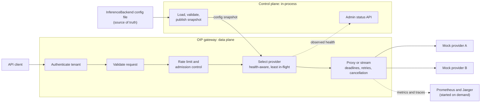
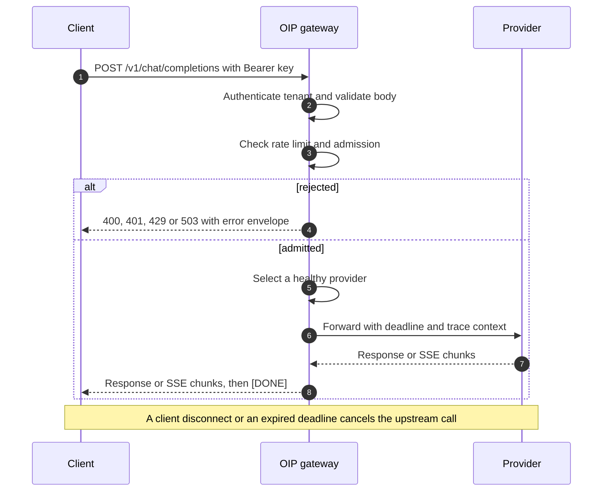

# Open Inference Platform (OIP)

> A small, production-minded inference gateway and provider control plane in Rust: built test-first, run locally on Docker Compose, and designed to be Kubernetes-ready without depending on Kubernetes.

| Status | Next milestone | Plan |
|---|---|---|
| Week 0: planning complete | M1 `v0.1.0` at the end of Week 5 | 26 weeks · 8–10 focused hours per week · one 8 GB laptop · no paid services |

## Contents

1. [Why OIP exists](#1-why-oip-exists)
2. [Target architecture](#2-target-architecture)
3. [Scope](#3-scope)
4. [Constraints and assumptions](#4-constraints-and-assumptions)
5. [Engineering principles](#5-engineering-principles)
6. [Roadmap at a glance](#6-roadmap-at-a-glance)
7. [Weekly operating model](#7-weekly-operating-model)
8. [Weekly plan](#8-weekly-plan)
9. [Quality strategy](#9-quality-strategy)
10. [Security and observability baselines](#10-security-and-observability-baselines)
11. [Decision schedule (ADRs)](#11-decision-schedule-adrs)
12. [Risk register](#12-risk-register)
13. [Repository layout](#13-repository-layout)
14. [After v1.0](#14-after-v10)
15. [References](#15-references)

---

## 1. Why OIP exists

**Primary goal:** become a stronger platform engineer, with Rust as the implementation language. OIP is the vehicle: a deliberately small platform that has to be designed, built, tested, packaged, observed, and operated, not just coded.

**What OIP is:** an inference gateway and provider-management control plane. It authenticates tenants, validates OpenAI-compatible requests, routes them to configured inference providers, streams responses back, and protects provider capacity under load.

**What OIP is not:** a replacement for Kubernetes, Envoy, KServe, vLLM, or any mature serving stack. Where a mature project owns a responsibility, OIP documents how it would integrate instead of rebuilding it.

**Definition of success (Week 26):** someone new to the project can clone the repository, run the platform on a laptop from the Quick start, and find evidence (tests, benchmarks, failure experiments, and ADRs) explaining how it behaves and why it was built that way.

### Outcomes at v1.0

1. A Rust (Tokio and Axum) gateway and deterministic mock providers behind a documented OpenAI-compatible API subset with tenant authentication.
2. Multi-provider routing, SSE streaming, deadlines, and cancellation.
3. Overload protection: bounded concurrency, per-tenant limits, rate limiting, admission control, circuit breaking, and budgeted retries.
4. A clear data-plane/control-plane boundary: a versioned backend contract, validated hot reload, and a status API.
5. Structured logs, metrics, traces, and SLOs that answer specific operational questions.
6. Hardened images and a repeatable Docker Compose workflow for development, testing, release, and rollback.
7. A supply-chain baseline: dependency audit, image scanning, SBOMs, and a signing experiment.
8. Evidence: a test-first history, a capacity report, incident reports, ADRs, and an ordered plan for Kubernetes.

---

## 2. Target architecture

The diagrams show OIP at v1.0. Each phase of the roadmap builds one slice of it.

### Components



### Request lifecycle



---

## 3. Scope

**In scope for Weeks 1–26**

- Rust gateway, deterministic mock providers, and a narrow provider abstraction.
- OpenAI-compatible API subset, tenant authentication, request validation, and a stable error model.
- Routing, streaming, deadlines, cancellation, and overload protection.
- An in-process control plane: file-based backend configuration, validated hot reload, and a read-only status API.
- Hardened container images, a Docker Compose workflow, metrics, tracing, and a security baseline.

**Deferred by design** (see [After v1.0](#14-after-v10) for when and in what order each item is revisited)

- All hands-on Kubernetes: Minikube, manifests, Helm, CRDs, controllers, RBAC, and NetworkPolicy. Concepts are studied every week; implementation starts in Week 27.
- PostgreSQL, Redis, and NATS, until a documented requirement triggers them (ADR-012).
- Real model hosting (Ollama, vLLM), GPUs, multi-node or multi-cluster setups, service meshes, and paid cloud.
- An always-on observability stack. Telemetry backends run only during the experiments that need them.
- Reimplementing mature gateways or serving platforms. This is a permanent non-goal, not a deferral.

---

## 4. Constraints and assumptions

| Item | Decision |
|---|---|
| Duration | 26 weeks, including stabilization time in Weeks 9, 13, and 22 |
| Effort | 8–10 focused hours per week (about 210–260 hours in total) |
| Hardware | 8 GB RAM laptop |
| Environment | WSL2, Docker Engine or Docker Desktop, Docker Compose; repository stored on the WSL filesystem |
| Language | Rust (stable toolchain pinned in `rust-toolchain.toml`) with Tokio, learned while building |
| Runtime | Docker Compose only, through Week 26 |
| Inference | Deterministic mock providers; no model weights required |
| Tooling | Free and open-source; licenses checked for crates, base images, and tools |
| Cloud | None required: no paid APIs, hosted model endpoints, or proprietary hosted services |

---

## 5. Engineering principles

These apply to every week. They are stated once here instead of being repeated in each weekly plan.

1. **Walking skeleton first.** The full request path runs end to end from Week 1, and every later week extends a working system.
2. **Bound everything.** Concurrency, queues, timeouts, retries, and memory have explicit limits, and behavior at each limit is tested.
3. **Fail fast, degrade predictably.** Invalid input and configuration fail loudly. Overload is rejected with documented errors, never absorbed silently.
4. **Kubernetes-ready, Kubernetes-free.** Configuration through environment and files, health endpoints, SIGTERM draining, stateless request handling, and clean images, with no Kubernetes dependency before v1.0.
5. **Every dependency earns its place.** No new service, external system, or major crate without a written reason (an ADR or commit note that includes its license). Optional services sit behind Compose profiles and run on demand.
6. **Small default footprint.** The default stack is the gateway plus mock providers, and it must leave room on an 8 GB laptop for an editor and a browser.
7. **Evidence over assertion.** Tests are seen failing before they pass, performance claims come from recorded measurements, and failure behavior comes from experiments.
8. **Integrate, don't reimplement.** OIP explores gateway and control-plane problems and documents where mature projects should take over.

---

## 6. Roadmap at a glance

Milestones are tagged when their exit gates pass, not on a calendar date. Each milestone ships with a demo script in `scripts/` that reproduces its demo from a clean stack.

| Phase | Weeks | Theme | Milestone | Demo at the milestone |
|---|---|---|---|---|
| [1](#phase-1-secure-walking-skeleton) | 1–5 | Secure walking skeleton | M1 · `v0.1.0` | An authenticated request flows from the gateway to a mock provider in Compose; bad keys and bad payloads never reach the provider; saturation is rejected; SIGTERM drains in-flight work |
| [2](#phase-2-inference-request-path) | 6–9 | Inference request path | M2 · `v0.2.0` | A streamed chat completion across two providers; deadlines and client disconnects stop upstream work |
| [3](#phase-3-operability-baseline) | 10–13 | Operability baseline | M3 · `v0.3.0` | Hardened non-root images, honest liveness and readiness, live metrics in Prometheus, an upgrade and rollback drill |
| [4](#phase-4-traffic-management-and-capacity) | 14–18 | Traffic management and capacity | M4 · `v0.4.0` | A provider outage and 2× overload under k6 with flat memory and isolated tenants, plus a capacity report |
| [5](#phase-5-control-plane) | 19–22 | Control plane | M5 · `v0.5.0` | A live backend change with no failed requests; a broken config rejected while the last-known-good keeps serving; a status API |
| [6](#phase-6-observability-security-and-release) | 23–26 | Observability, security, and release | M6 · `v1.0.0` | End-to-end traces and SLOs, security and incident reports, and a Quick start that works on a clean machine |

### Progress tracker

Update this table in the Close block of every week. Status values: `Not started`, `In progress`, `Done`, `Slipped to Week N`.

| Week | Focus | Status |
|---:|---|---|
| 1 | Charter and walking skeleton | Not started |
| 2 | Deterministic mock provider | Not started |
| 3 | API contract and error model | Not started |
| 4 | Tenant authentication | Not started |
| 5 | Bounded concurrency and graceful shutdown · **M1** | Not started |
| 6 | Multi-provider routing | Not started |
| 7 | SSE streaming | Not started |
| 8 | Deadlines, cancellation, and error taxonomy | Not started |
| 9 | Stabilize and release · **M2** | Not started |
| 10 | Production images and container hardening | Not started |
| 11 | Health semantics and recovery | Not started |
| 12 | Metrics foundation | Not started |
| 13 | Release workflow and stabilize · **M3** | Not started |
| 14 | Provider health and capacity-aware routing | Not started |
| 15 | Admission control and tenant fairness | Not started |
| 16 | Per-tenant rate limiting | Not started |
| 17 | Retries, failover, and retry budgets | Not started |
| 18 | Load testing and capacity report · **M4** | Not started |
| 19 | Control-plane boundary and backend contract | Not started |
| 20 | Dynamic configuration with last-known-good | Not started |
| 21 | Status API and stateful-dependency decision | Not started |
| 22 | Stabilize and release · **M5** | Not started |
| 23 | Distributed tracing and SLOs | Not started |
| 24 | Supply chain and security review | Not started |
| 25 | Failure experiments and final load test | Not started |
| 26 | v1.0 release and retrospective · **M6** | Not started |

---

## 7. Weekly operating model

### Weekly rhythm (about 9 hours)

| Block | Time | Output |
|---|---:|---|
| Plan | 1.5 h | Acceptance criteria, risks, and the list of failing tests to write; 20–30 minutes on the week's Kubernetes concept |
| Build | 5 h | Red, green, refactor, one acceptance criterion at a time |
| Integrate and break | 1.5 h | Rebuilt images, the Compose stack running, end-to-end tests, and the week's failure check |
| Close | 1 h | Docs and ADRs updated, progress tracker updated, a 10-minute retro comparing planned and actual hours |

**Reading track (Weeks 19–25):** add about 30 minutes per week to read one ecosystem project's architecture documentation and write a one-page note in `docs/research/`. Order: KServe, llm-d, LiteLLM, Envoy AI Gateway, Gateway API Inference Extension, vLLM, Ollama. The notes feed the integrate-versus-build write-up in Week 26.

### How to read a week

- **Goal:** the outcome in one sentence.
- **Build:** the must-have scope, kept small on purpose.
- **Done when:** the exit gate. Each line is proven by a test or a recorded observation, and the tests are written first.
- **Watch out:** a known pitfall worth planning around (only where it is useful).
- **Concepts:** the Rust, platform, and Kubernetes ideas the work exercises. No separate study time is budgeted; learn them while building.
- **Stretch:** optional, and only after every must-have is done.

### Definition of done (every week)

- [ ] Acceptance criteria were written before code, and each must-have has a test that was observed failing first.
- [ ] `make check` passes: formatting, Clippy with warnings denied, all tests, and `cargo audit`.
- [ ] Affected images are rebuilt, and `make e2e` passes against a freshly started Compose stack.
- [ ] The week's failure mode or limit was exercised, where relevant.
- [ ] No secrets, API keys, or prompt content appear in logs, metrics, traces, or error responses.
- [ ] Docs, ADRs, and the progress tracker are updated.
- [ ] Every new dependency or service has a recorded reason and license check.

For design-only work, replace the implementation and runtime checks with a written review against the acceptance criteria.

### Slip policy

1. Never cut acceptance tests or the Compose integration check to finish a week on time.
2. Drop stretch items first.
3. Move unfinished must-haves to the next stabilization week (Week 9, 13, or 22) and record it in the progress tracker.
4. If that stabilization week is already full, re-plan explicitly: defer the lowest-value upcoming must-have with an ADR, or set a new end date. The plan never drifts silently.

### Changing the plan

Adjust a week's plan during its Plan block, before writing code, never after the fact to match what was built. Record any change to scope or sequence in the progress tracker or an ADR.

---

## 8. Weekly plan

### Phase 1: Secure walking skeleton

**Weeks 1–5 · Milestone M1 `v0.1.0`.** A thin but real request path: authenticated, validated, bounded, and gracefully stoppable, running in Docker Compose.

#### Week 1: Charter and walking skeleton

**Goal:** one request travels from `curl` through the gateway to a mock provider and back, inside Docker Compose, from a single command.

- **Build:**
  - Review sections 1–5 of this README as the project charter, and adjust anything that no longer holds before writing code.
  - A Cargo workspace with two binaries, `apps/gateway` and `apps/mock-provider`, and a `rust-toolchain.toml` that pins a stable toolchain.
  - `GET /healthz` on both services, written test-first.
  - The gateway forwards `POST /v1/chat/completions` to the mock unchanged; the mock returns a fixed completion that identifies which mock produced it.
  - Multi-stage Dockerfiles, `compose.yaml`, and a `Makefile` with `check`, `up`, `down`, `logs`, and `e2e`. The end-to-end suite starts as a single test.
  - `make check` runs `cargo fmt --check`, Clippy with warnings denied, `cargo test`, and `cargo audit`.
  - A Quick start section near the top of this README, and ADR-001.
- **Done when:**
  - From a fresh clone, `make check && make up && make e2e` passes.
  - The health-endpoint tests were observed failing before the handlers existed.
  - The end-to-end test proves the response came from the mock provider, not from a gateway stub.
- **Watch out:** keep the repository on the WSL filesystem (for example `~/src/oip`), not under `/mnt/c`. File access across the Windows boundary makes builds dramatically slower.
- **Concepts:** Rust: Cargo workspaces, modules, `Result` and `?`, Axum routers and handlers · Platform: walking skeletons, ADRs · Kubernetes: why orchestration exists; declarative desired state.
- **Stretch:** BuildKit cache mounts in the Dockerfiles to speed up rebuilds.

#### Week 2: Deterministic mock provider

**Goal:** a mock provider that reproduces every behavior later weeks need to test, identically on every run.

- **Build:**
  - Scenarios: deterministic success, fixed delay, error status, malformed body, slow first byte, and hang (never responds).
  - Scenario directives travel inside the request body (for example, a `mock:` line in the last user message). The gateway forwards them untouched, so routing and metrics never see them. A per-instance default scenario comes from configuration.
  - Test hooks: `GET /_mock/stats` reports request counts per test ID carried in the directive, so a test can assert exactly how many upstream calls its own requests caused, even when tests run in parallel.
  - Configuration from environment variables, validated at startup.
  - Explicit SIGTERM handling for clean, fast container stops.
- **Done when:**
  - Every scenario has a native test, and the same assertions pass against the running container.
  - Two identical requests produce byte-identical responses.
  - `docker compose stop mock-provider` returns well within Docker's 10-second default stop timeout.
- **Watch out:** a process running as PID 1 in a container ignores SIGTERM unless it installs a handler, so `docker compose stop` would wait out the timeout and then kill it.
- **Concepts:** Rust: the Tokio runtime, `async fn`, `tokio::time`, Axum extractors and shared state, enums for scenarios · Platform: test doubles, deterministic simulation · Kubernetes: Pods versus containers; the container lifecycle.
- **Stretch:** a seeded jitter mode that adds realistic variance while staying reproducible.

#### Week 3: API contract and error model

**Goal:** the gateway speaks a documented subset of the OpenAI Chat Completions API, rejects bad requests before any provider work, and fails with stable, documented errors.

- **Build:**
  - Request and response types for the non-streaming `POST /v1/chat/completions` subset: `model`, `messages`, `max_tokens`, `temperature`, and `stream` (which returns a clear "not supported yet" error until Week 7).
  - Validation before any upstream call: non-empty `messages`, known roles, bounded `max_tokens`, and a request body size limit.
  - An error envelope modeled on the OpenAI error object, with one error type per failure class mapped to HTTP status codes in a single place.
  - Upstream failure mapping: provider error statuses, malformed provider responses, and connection failures each map to a documented gateway status.
  - Request IDs: accept or generate `x-request-id`, return it on every response, and include it in structured JSON logs written with `tracing`.
  - `docs/api.md` with `curl` examples, and ADR-002.
- **Done when:**
  - Invalid payloads return `400` with the documented envelope, and the mock's counters show zero upstream calls.
  - Each upstream failure scenario from Week 2 maps to its documented gateway status.
  - Bodies above the configured limit are rejected with `413`.
  - Every response, including errors, carries an `x-request-id` that also appears in that request's log line.
- **Watch out:** rejecting unknown fields breaks real OpenAI clients, which send many optional fields; ignoring them silently hides mistakes. Make the choice explicit in ADR-002.
- **Concepts:** Rust: Serde derive, `thiserror` for typed errors (with `anyhow` only at binary edges), `IntoResponse`, `From` conversions · Platform: API contracts, compatibility, error taxonomies · Kubernetes: API versioning and compatibility guarantees.
- **Stretch:** `GET /v1/models`, listing the models the gateway can route.

#### Week 4: Tenant authentication

**Goal:** every request is tied to a tenant before any work happens, and credentials never leak.

- **Build:**
  - `Authorization: Bearer <key>` is mapped to a tenant ID through configuration; the tenant context is stored in request extensions for the per-tenant limits in Phase 4.
  - Keys are stored only as hashes in configuration and compared in constant time. Plaintext development keys live only in a git-ignored `.env`, with fake values in `.env.example`.
  - Keys carry a recognizable prefix so leaked keys are easy to detect.
  - Authentication runs as a Tower/Axum layer, so no handler can forget it.
  - The `Authorization` header and request bodies are never logged.
  - `docs/security/threat-model.md` (one page: assets, entry points, trust boundaries), and ADR-003.
- **Done when:**
  - Missing, malformed, and unknown keys get `401` with the error envelope, and the mock records zero upstream calls.
  - A test captures the log output of an authenticated request and asserts that the tenant ID is present and the key is absent.
  - A secret-pattern check in `make check` finds no plaintext keys in tracked files.
- **Watch out:** API keys are high-entropy random tokens, so a fast hash such as SHA-256 is generally considered sufficient, unlike passwords. Confirm this against current OWASP guidance when writing ADR-003.
- **Concepts:** Rust: Tower `Service` and `Layer`, Axum middleware, request extensions, a secret newtype whose `Debug` output is redacted · Platform: authentication versus authorization, trust boundaries · Kubernetes: Secrets versus ConfigMaps.
- **Stretch:** two active keys per tenant, to rehearse key rotation.

#### Week 5: Bounded concurrency and graceful shutdown

**Goal:** the gateway never accepts more work than it can hold, and stopping it never drops a request it has already accepted.

- **Build:**
  - A configurable global in-flight limit. ADR-004 decides what happens when it is full: an immediate `503` with `Retry-After`, or a short bounded wait.
  - Graceful shutdown on SIGTERM and Ctrl-C: stop accepting new connections, let in-flight requests finish until a drain deadline, then exit.
  - The Compose `stop_grace_period` is set longer than the drain deadline.
  - An M1 demo script (`scripts/demo-m1.sh`); tag `v0.1.0`.
- **Done when:**
  - With the limit set to N and N slow requests in flight, request N+1 gets the documented saturation response (deterministic test using the mock's delay scenario).
  - Running `docker compose stop gateway` during in-flight requests lets them all complete, refuses new requests, and exits before the grace period ends.
  - A request still running at the drain deadline is cut off with a logged reason, not dropped silently.
- **Watch out:** a concurrency permit must be released on every path, including errors and client disconnects. Tie it to a guard value that is dropped when the request ends instead of releasing it by hand.
- **Concepts:** Rust: `Arc`, `tokio::sync::Semaphore`, `tokio::select!`, `Drop` guards, `Send` and `Sync` · Platform: backpressure, async concurrency versus CPU parallelism · Kubernetes: Pod termination (SIGTERM, grace period, `preStop` hooks).
- **Stretch:** expose the current in-flight count on a debug endpoint (replaced by metrics in Week 12).

> **Milestone M1 · `v0.1.0`.** Demo: an authenticated request end to end in Compose; an invalid key and an invalid payload never reach the provider; saturation is rejected; stopping the gateway drains in-flight work.

### Phase 2: Inference request path

**Weeks 6–9 · Milestone M2 `v0.2.0`.** Multiple providers, streaming, and deadline discipline: the core of an inference gateway.

#### Week 6: Multi-provider routing

**Goal:** requests for a model are spread across every provider that serves it, and the gateway fails clearly when none can.

- **Build:**
  - A provider registry from configuration: provider ID, base URL, and models served.
  - Model-to-pool resolution and round-robin selection within the pool, behind a small routing-policy trait.
  - A second mock provider in Compose with a different default latency.
  - A documented error for unknown models, and the selected provider ID in each request's log line (never request content).
- **Done when:**
  - Over 10 requests, each of two providers receives exactly 5, verified with the mocks' counters.
  - A model served by only one provider always reaches that provider.
  - Unknown models return the documented error without any upstream call.
  - With one provider stopped, its share of requests fails fast with the documented upstream error instead of hanging. Health-aware routing arrives in Week 14.
- **Watch out:** keep routing decisions free of I/O (a pure function over the provider list and policy state), so the policies added in Week 14 can be unit-tested without HTTP.
- **Concepts:** Rust: trait objects versus generics, `AtomicUsize`, sharing state with `Arc` · Platform: load-balancing algorithms, service discovery · Kubernetes: Services, EndpointSlices, and how kube-proxy balances traffic.
- **Stretch:** weighted round-robin.

#### Week 7: SSE streaming

**Goal:** streamed completions reach the client chunk by chunk as the provider produces them, and an abandoned stream stops costing upstream work.

- **Build:**
  - `stream: true` support end to end.
  - A mock streaming scenario: N deterministic chunks at a fixed interval, terminated by `data: [DONE]`.
  - The gateway forwards chunks as they arrive, without buffering the full response.
  - Defined behavior for a provider failure mid-stream (a terminal error event, then close), documented in `docs/api.md`.
  - Client disconnects propagate: the upstream request is dropped, and the mock records a cancelled stream.
- **Done when:**
  - With a 10-chunk scenario at 100 ms per chunk, the first chunk reaches the client within 300 ms, while the full stream takes about one second.
  - Every successful stream ends with `[DONE]`, and a mid-stream failure ends with the documented error event.
  - Disconnecting after the third chunk makes the mock record a cancellation within one second.
- **Watch out:** any layer that buffers the body, such as compression or response logging middleware, silently breaks streaming. Test through the full Compose path, not only in-process.
- **Concepts:** Rust: `Stream`, `Pin`, `StreamExt`, streaming response bodies, cancellation through `Drop` · Platform: SSE framing, chunked transfer, proxy buffering · Kubernetes: proxy and ingress timeouts for long-lived connections.
- **Stretch:** a slow-consumer test showing that a slowly reading client does not make gateway memory grow without bound.

#### Week 8: Deadlines, cancellation, and error taxonomy

**Goal:** no request outlives its time budget, and every failure is classified for the circuit-breaking and retry work in Phase 4.

- **Build:**
  - Time budgets: an overall request deadline, an upstream connect timeout, a time-to-first-byte timeout, and a stream idle timeout. All are configurable and apply to streaming and non-streaming paths.
  - Explicit HTTP client pool settings (idle timeout, maximum idle connections per provider), each documented with the reason for its value.
  - An error taxonomy: retryable versus terminal, and whether the failure happened before or after the first byte reached the client.
  - Timeouts map to documented statuses (for example `504`), and ADR-005.
- **Done when:**
  - Each timeout has a unit test on Tokio's paused clock (no real sleeps) and an end-to-end test against the mock's delay or hang scenarios.
  - A timed-out request's upstream call is cancelled, as shown by the mock's counters.
  - In the end-to-end timeout scenarios, no request exceeds the overall deadline plus a small documented margin.
- **Watch out:** per-step timeouts do not add up to a deadline. Derive each step's timeout from the remaining budget, or a slow connect plus a slow first byte can exceed the overall limit.
- **Concepts:** Rust: `tokio::time::timeout`, paused-time tests (`start_paused`), HTTP client configuration · Platform: deadline propagation, connection pooling, and keep-alive · Kubernetes: Service DNS and connection reuse across Pod restarts.
- **Stretch:** propagate the remaining deadline to providers in a request header.

#### Week 9: Stabilize and release

**Goal:** pay down the slip and debt from Weeks 1–8, then release a demonstrable inference gateway.

- **Build:**
  - Finish any must-haves rolled forward from earlier weeks.
  - Refactor where real boundaries have appeared (for example, extract a `provider-client` crate); create no speculative crates.
  - Make the end-to-end suite run from a clean stack: `make down && make up && make e2e`.
  - Update the architecture diagrams and `docs/api.md`; write the M2 demo script; tag `v0.2.0`.
- **Done when:** all Week 1–8 exit gates are ticked, the end-to-end suite passes twice in a row from a clean start (which catches order-dependent tests), and `v0.2.0` is tagged.
- **Concepts:** Kubernetes: Services and DNS-based discovery, compared with Compose networking.
- **Stretch:** if nothing slipped, start Week 10 early.

> **Milestone M2 · `v0.2.0`.** Demo: a streamed chat completion across two providers; a slow provider hits its deadline; disconnecting the client stops upstream work.

### Phase 3: Operability baseline

**Weeks 10–13 · Milestone M3 `v0.3.0`.** The platform becomes operable: hardened images, honest health signals, metrics, and a rehearsed release and rollback.

#### Week 10: Production images and container hardening

**Goal:** small, reproducible, least-privilege images that pass the full test suite unchanged.

- **Build:**
  - Multi-stage builds with dependency-layer caching (BuildKit cache mounts or a dependency-only build stage, chosen by measured rebuild time).
  - A minimal runtime base image, chosen and recorded (for example distroless versus slim), and pinned by digest.
  - A non-root user, a read-only root filesystem (with tmpfs only where needed), all capabilities dropped, and `no-new-privileges`, all set in Compose.
  - A built-in `healthcheck` subcommand in each binary for Compose health checks, because minimal images have no shell or `curl`.
  - Image size, cold and warm build times, and startup time recorded in `docs/experiments/`.
- **Done when:**
  - Both services run as non-root with a read-only root filesystem and no capabilities, and `make e2e` passes unchanged.
  - A one-line code change rebuilds measurably faster than a cold build, with the numbers recorded.
  - Base images are referenced by digest, and their licenses are noted.
- **Watch out:** Rust builds are memory-hungry. On 8 GB, limit parallel compile jobs inside Docker builds if they get killed for running out of memory, and give WSL2 an explicit memory cap so Windows stays responsive.
- **Concepts:** Rust: release profiles, static versus dynamic linking (glibc versus musl trade-offs) · Platform: layer caching, image provenance, Linux namespaces and cgroups, PID 1 signal behavior · Kubernetes: images, tags versus digests, `imagePullPolicy`, `securityContext`.
- **Stretch:** compare two base images by size and known vulnerabilities, as a preview of Week 24.

#### Week 11: Health semantics and recovery

**Goal:** health signals tell the truth, and the stack recovers from container failures without manual help.

- **Build:**
  - `/livez` (the process can serve) and `/readyz` (configuration loaded and not draining) replace `/healthz`. ADR-006 records the semantics, including whether provider health affects readiness.
  - Readiness turns false as soon as draining starts (the Week 5 shutdown path).
  - Memory and CPU measured under a fixed mock workload; Compose resource limits set with recorded headroom.
  - Recovery drills: kill a provider under traffic and restart it; restart the gateway under traffic. Observations are recorded in `docs/experiments/`.
- **Done when:**
  - Liveness and readiness transitions, including during drain, are covered by tests.
  - During a provider outage, requests to it fail with documented errors and recover automatically when it returns, without a gateway restart.
  - Resource limits are justified by measurements, not guesses.
- **Watch out:** if readiness depends on provider health, a single provider outage takes every gateway out of rotation at once, exactly when partial service matters most.
- **Concepts:** Rust: health state shared between tasks (`tokio::sync::watch`) · Platform: liveness versus readiness versus startup, cascading failure, restart policies · Kubernetes: probes, restart policy, requests versus limits, OOMKilled, QoS classes.
- **Stretch:** a startup state for slow initialization.

#### Week 12: Metrics foundation

**Goal:** the gateway exposes the measurements that Phase 4's capacity work depends on.

- **Build:**
  - `/metrics` in Prometheus text format: request rate, errors, and latency histograms by route, status class, and provider; in-flight requests; concurrency rejections; upstream errors by taxonomy class.
  - A label policy in ADR-007: only bounded label values; tenant labels only if the tenant set is bounded by configuration; never request content. ADR-007 also records the metrics crate chosen, after checking its maintenance and license.
  - Prometheus as an optional `obs` Compose profile, with the scrape configuration committed.
- **Done when:**
  - Tests assert that each metric changes on success, error, timeout, and rejection.
  - `docker compose --profile obs up` shows live metrics in Prometheus, and stopping the profile leaves the default stack unaffected.
  - The total number of time series stays within a documented bound while the end-to-end suite runs.
- **Watch out:** a single unbounded label (a request ID, a raw path, or a client-supplied model name) can blow up memory in Prometheus and in the gateway's own registry. Normalize model names to configured values.
- **Concepts:** Rust: sharing a registry across handlers, histogram buckets · Platform: the RED and USE methods, cardinality, pull-based scraping · Kubernetes: how Prometheus discovers scrape targets in a cluster.
- **Stretch:** `docs/operations/promql.md` with the queries that answer "is it healthy?" and "is it saturated?".

#### Week 13: Release workflow and stabilize

**Goal:** a known version can be built, started, upgraded, and rolled back on demand, and any Phase 3 slip is absorbed.

- **Build (about half the week):**
  - A version scheme: SemVer git tags, with images tagged by version and commit SHA.
  - Compose profiles: the default (gateway and mocks) and `obs`. A `load` profile follows in Week 18.
  - `.env.example` covers every setting, and startup fails fast on missing or invalid values.
  - Upgrade (`v0.2.0` to the current version) and rollback drills under light traffic, written up in `docs/operations/release.md`.
  - `docs/architecture/kubernetes-mapping.md`: Compose service to Deployment and Service, environment to ConfigMap and Secret, health checks to probes, resource limits to requests and limits, `stop_grace_period` to `terminationGracePeriodSeconds`.
- **Remaining time:** finish rolled-forward must-haves, then tag `v0.3.0`.
- **Done when:** the upgrade and rollback drills show only documented, transient errors; the mapping document exists; and all Phase 3 exit gates are ticked.
- **Concepts:** Kubernetes: Deployments, rolling updates (`maxSurge`, `maxUnavailable`), rollback.
- **Stretch:** a `make release VERSION=x.y.z` target that tags, builds, and runs the end-to-end suite.

> **Milestone M3 · `v0.3.0`.** Demo: hardened images, readiness flipping during drain, live metrics in Prometheus, and an upgrade followed by a rollback.

### Phase 4: Traffic management and capacity

**Weeks 14–18 · Milestone M4 `v0.4.0`.** The gateway protects providers and tenants from each other and from overload, and proves it under load.

#### Week 14: Provider health and capacity-aware routing

**Goal:** traffic flows away from failing providers and toward providers with spare capacity.

- **Build:**
  - Passive health per provider, implemented as a circuit breaker: it opens after consecutive failures (classified by the Week 8 taxonomy), allows a trial request after a cooldown, and closes again on success.
  - Least-in-flight routing alongside round-robin, selectable per model pool in configuration.
  - Documented behavior when every provider in a pool is unavailable: fail fast with `503`.
  - Metrics for routing decisions and breaker transitions, and ADR-008.
- **Done when:**
  - With one provider failing, its breaker opens after the configured threshold, and later requests go to the healthy provider.
  - After the cooldown, a single successful trial request closes the breaker.
  - With a fast and a slow provider, least-in-flight sends measurably more traffic to the fast one.
  - The breaker state machine is unit-tested on the paused clock.
- **Watch out:** keep breaker and in-flight bookkeeping out of any global lock on the request path; contention there will show up in the Week 18 benchmark.
- **Concepts:** Rust: enum state machines; atomics versus `Mutex` versus a dedicated task · Platform: circuit breakers, outlier detection, least-request and power-of-two-choices balancing · Kubernetes: readiness-based endpoint removal.
- **Stretch:** active health checks that probe unavailable providers instead of waiting for real traffic.

#### Week 15: Admission control and tenant fairness

**Goal:** under overload, the gateway sheds excess work explicitly, and one tenant cannot starve the others.

- **Build:**
  - Per-tenant concurrency limits from configuration, enforced before the global limit.
  - An overload policy decided in ADR-009: immediate rejection, or a short bounded queue with a maximum wait. Implement the simpler option that meets the acceptance criteria.
  - Load shedding: when the queue is full or the wait expires, return `503` with `Retry-After`.
  - Metrics for queue depth, wait time, and rejections by reason.
- **Done when:**
  - Tenant A flooding the gateway does not change tenant B's success rate, in a deterministic test.
  - The queue never exceeds its bound, and no request waits longer than the configured maximum.
  - Under twice the sustainable load in Compose, gateway memory stays flat (recorded with `docker stats`).
- **Watch out:** a queue only helps with short bursts. Under sustained overload, it just adds latency before the same rejection.
- **Concepts:** Rust: per-key semaphores built when configuration loads, bounded channels, timeouts on acquisition · Platform: Little's Law, queueing delay versus rejection, load shedding · Kubernetes: API Priority and Fairness, ResourceQuota.
- **Stretch:** weighted fairness, such as a tenant tier with a larger share.

#### Week 16: Per-tenant rate limiting

**Goal:** each tenant gets a predictable request rate with bursts, and limited requests are told when to retry.

- **Build:**
  - A token bucket per tenant (rate and burst from configuration), checked after authentication and validation and before admission control.
  - `429` responses with a `Retry-After` value computed from the bucket state.
  - Rate-limited requests counted in metrics.
  - ADR-009 extended with the rate-limit policy, including why the in-memory limiter is only correct for a single gateway replica and what would trigger a shared store (input to ADR-012).
- **Done when:**
  - A burst of B requests passes, and request B+1 gets `429` with a correct `Retry-After`, tested on the paused clock.
  - Tokens refill at the configured rate, tested on the paused clock with no sleeps.
  - One tenant's limit never affects another tenant.
- **Watch out:** this week is intentionally lighter. Use the spare time to finish anything rolled forward, not to add features.
- **Concepts:** Rust: `Instant` arithmetic, lazy refill instead of background timers · Platform: token bucket versus leaky bucket versus sliding window; HTTP `429` and `Retry-After` · Kubernetes: API server rate limiting, revisiting API Priority and Fairness.
- **Stretch:** limit by estimated tokens (`max_tokens`) instead of request count, which is cost-aware rate limiting for inference.

#### Week 17: Retries, failover, and retry budgets

**Goal:** transient provider failures are hidden from clients without ever multiplying load on a struggling system.

- **Build:**
  - Retry only errors classified as retryable in Week 8, and only before the first byte has been sent to the client.
  - Fail over to a different provider in the pool where one is available, and skip providers whose circuit breaker is open.
  - Cap attempts per request and enforce a retry budget (retries limited to a fixed share of recent requests), with exponential backoff and jitter. The remaining deadline always wins.
  - Metrics for attempts, retries, and budget exhaustion, and ADR-010.
- **Done when:**
  - When a provider returns a retryable error before the first byte, the request succeeds through the other provider with exactly one retry (checked with the mocks' counters).
  - A failure after streaming has started is never retried; the client gets the documented error event.
  - With every provider failing, total upstream attempts stay within (1 + budget) × requests, so there is no retry storm.
  - Retries never extend a request beyond its overall deadline.
- **Watch out:** a retry against a provider with an open circuit breaker must be skipped, not counted as a new failure, or the breaker and the retry logic amplify each other.
- **Concepts:** Rust: composing async policies, deterministic jitter in tests · Platform: retry amplification, retry budgets, idempotency of inference requests (a duplicate costs money but changes no state) · Kubernetes: Horizontal Pod Autoscaler concepts, and why autoscaling does not replace load shedding.
- **Stretch:** skip a retry when the remaining deadline is shorter than the provider's typical latency (using Week 12 metrics).

#### Week 18: Load testing and capacity report

**Goal:** replace assumptions with measurements: how much OIP handles on this laptop, where it saturates, and how it fails.

- **Build:**
  - k6 scenarios in `benchmarks/`, run through a `load` Compose profile: a steady baseline, a step-up to find the saturation point, 2× overload, a provider outage under load, and a noisy tenant.
  - Arrival-rate (open-model) executors, so slow responses cannot hide latency.
  - Short runs against release builds with the `obs` profile running, one scenario at a time, to respect the 8 GB limit.
  - A comparison of round-robin and least-in-flight under identical conditions.
  - `benchmarks/REPORT.md`: method, environment, results (throughput, error rate, p50, p95, p99), saturation point, the next bottleneck, and limitations. Tag `v0.4.0`.
- **Done when:**
  - Every scenario is reproducible from one documented command.
  - Overload produces explicit rejections with flat memory, not timeouts or crashes.
  - Any limit changed this week cites a number from the report.
- **Watch out:** k6, Prometheus, and the stack compete for the same CPU. Record k6's own resource use, and treat results as relative comparisons, not production capacity.
- **Concepts:** Platform: open versus closed workload models, coordinated omission, percentiles, Little's Law in practice · Kubernetes: Horizontal Pod Autoscaler and capacity planning with requests and limits.
- **Stretch:** a CPU flamegraph of the gateway under the baseline scenario.

> **Milestone M4 · `v0.4.0`.** Demo: a provider outage and 2× overload under k6, with flat memory and isolated tenants, plus the capacity report.

### Phase 5: Control plane

**Weeks 19–22 · Milestone M5 `v0.5.0`.** Separate "what should exist" from "what is happening": a versioned backend contract, safe live reconfiguration, and an honest status view, without new infrastructure.

#### Week 19: Control-plane boundary and backend contract

**Goal:** provider configuration becomes a versioned, validated contract with a clear owner, ready to map to a Kubernetes custom resource later.

- **Build:**
  - The boundary in writing: the data plane serves requests from an immutable configuration snapshot; the control plane loads, validates, and publishes snapshots and reports status.
  - An `InferenceBackend` schema at `v1alpha1` in a Kubernetes-style shape (`apiVersion`, `kind`, `metadata`, `spec`): endpoint, models served, capacity (maximum in-flight), routing policy, and an enabled flag.
  - A status model that separates desired from observed state, using conditions such as `Accepted` (the spec is valid) and `Healthy` (as observed by routing).
  - The Week 6 provider registry migrated to the new format.
  - ADR-011: the configuration file is the single source of truth and the API is read-only; a database-backed registry is deferred, with explicit triggers.
- **Done when:**
  - Contract tests cover valid specs, duplicate names, invalid endpoints, unsupported versions, and unknown fields.
  - The full end-to-end suite passes on the new configuration format.
  - `docs/architecture/backend-contract.md` documents the schema with annotated examples.
- **Watch out:** parse, don't validate. Turn raw configuration into types that cannot represent invalid states, so the data plane never has to re-check them.
- **Concepts:** Rust: Serde enums and tagged representations, validated newtypes · Platform: control plane versus data plane, desired versus observed state · Kubernetes: CRDs, `spec` and `status`, conditions, API versioning (`v1alpha1` to `v1`).
- **Stretch:** generate a JSON Schema from the types for editor validation.

#### Week 20: Dynamic configuration with last-known-good

**Goal:** backends can be added, changed, or disabled while serving traffic, and a bad change can never take the gateway down.

- **Build:**
  - A reload trigger: `SIGHUP` (for example `docker compose kill -s HUP gateway`). The admin API added in Week 21 stays read-only, as ADR-011 decides.
  - Validate the complete new configuration before applying anything, then publish it as a new immutable snapshot (for example through `tokio::sync::watch`).
  - In-flight requests finish on the snapshot they started with.
  - Invalid configuration is rejected, logged, and counted; the last-known-good snapshot keeps serving.
  - A configuration generation number in logs and metrics; reloads are serialized.
  - Routing state (circuit breakers and in-flight counts) carries over for backends that did not change.
  - Tenant configuration stays restart-only in v1.0.
- **Done when:**
  - Adding and disabling a backend under streaming traffic causes zero failed requests, in an end-to-end test.
  - An invalid file leaves serving unaffected and is visible in metrics and logs.
  - Two concurrent reloads never produce a mixed configuration.
  - At startup, an invalid file still fails fast, and the difference between startup and reload behavior is documented.
- **Watch out:** rebuilding routing state on every reload silently resets circuit breakers and in-flight counts. Carry state over by backend name, and test it.
- **Concepts:** Rust: `watch` channels, immutable snapshots behind `Arc`, ownership across tasks · Platform: reconciliation, level-triggered versus edge-triggered designs · Kubernetes: ConfigMap updates in mounted volumes, controller reconcile loops.
- **Stretch:** reload automatically when the file changes.

#### Week 21: Status API and stateful-dependency decision

**Goal:** operators can see desired versus observed state for every backend, and "do we need a database, Redis, or NATS?" gets a written answer.

- **Build:**
  - An admin listener on a separate port with its own credential, published only on `127.0.0.1`.
  - Read-only endpoints: backends with their spec and status conditions, plus the configuration generation and the last reload result. Secrets are redacted.
  - ADR-012 on stateful dependencies, with an explicit trigger for each:
    - PostgreSQL: configuration needs API writes that survive restarts, change history, or multiple writers.
    - Redis: two or more gateway replicas need globally consistent rate limits or quotas.
    - NATS: several gateways need asynchronous configuration or status fan-out.
  - The likely outcome with a single gateway replica: all three deferred, each with its trigger.
- **Done when:**
  - Status reflects a provider going down and coming back, in an end-to-end test.
  - Tenant keys are rejected on the admin listener, and the admin credential is rejected on the tenant API.
  - ADR-012 is accepted, and every deferred tool appears in the [backlog](#backlog-with-entry-triggers) with its trigger.
- **Watch out:** a status API that reads routing state must not take locks that the request path needs.
- **Concepts:** Platform: separating admin and data APIs, least privilege · Kubernetes: RBAC, the status subresource, and why controllers write status while users write spec.
- **Stretch:** a dry-run endpoint that validates a proposed configuration without applying it.

#### Week 22: Stabilize and release

**Goal:** absorb the slip from Phases 4 and 5, and release the control-plane milestone.

- **Build:**
  - Finish rolled-forward must-haves.
  - End-to-end tests for reload scenarios (a valid change, an invalid change, and a change during streaming), run from a clean stack.
  - Refactor the control-plane code, update the diagrams, write the M5 demo script, and tag `v0.5.0`.
- **Done when:** the Phase 4 and Phase 5 exit gates are ticked, and the reload tests pass twice in a row from a clean start.
- **Concepts:** Kubernetes: StatefulSets and operators, and what changes when state enters the picture.
- **Stretch:** if nothing slipped, start Week 23 early.

> **Milestone M5 · `v0.5.0`.** Demo: change backends live with no failed requests, push a broken configuration and watch the last-known-good keep serving, and inspect both through the status API.

### Phase 6: Observability, security, and release

**Weeks 23–26 · Milestone M6 `v1.0.0`.** Make behavior explainable, artifacts trustworthy, and failure modes documented, then ship.

#### Week 23: Distributed tracing and SLOs

**Goal:** any single request can be followed across services, and the platform has explicit reliability targets.

- **Build:**
  - OpenTelemetry tracing in the gateway and mock providers, with spans for authentication, admission, routing, each upstream attempt, and streaming.
  - W3C Trace Context propagation from the gateway to providers, and trace IDs in log lines.
  - Jaeger in the `obs` profile, receiving OTLP.
  - Span attributes never include prompts, completions, or keys.
  - Two SLIs (for example, the share of admitted requests without a server error, and p95 time to first byte) with SLOs derived from the Week 18 baseline, in `docs/operations/slo.md`.
  - ADR-013 on the telemetry stack, amending ADR-007.
- **Done when:**
  - A retried request shows both attempts under one trace in Jaeger.
  - Tests assert trace-context propagation and attribute redaction.
  - Running without the `obs` profile has no effect on serving; exporter failures are non-fatal.
- **Watch out:** a slow or missing collector must never slow the request path. Export asynchronously, with bounded buffers that drop spans instead of blocking.
- **Concepts:** Rust: `tracing` subscriber layers, bridging `tracing` spans to OpenTelemetry · Platform: trace context, sampling, SLIs, SLOs, error budgets · Kubernetes: running an OpenTelemetry Collector as a DaemonSet or sidecar.
- **Stretch:** one Grafana dashboard showing the two SLIs.

#### Week 24: Supply chain and security review

**Goal:** every release artifact can be scanned, described, and verified with one command, and every finding has a decision.

- **Build:**
  - `make security`: `cargo audit`, Trivy image and filesystem scans, a Syft SBOM per image, and Grype run against each SBOM.
  - A Cosign signing and verification experiment with a local key pair, documenting what a signature proves and what it does not.
  - Findings triage in `docs/security/findings.md`: fix, accept with a reason, or defer to a named week or backlog item.
  - A review of the Week 4 threat model against the current system (admin API, reload, telemetry).
  - Optional: a self-hosted open-source CI runner (Woodpecker CI or Forgejo Actions) running `make check` and `make security`.
- **Done when:**
  - `make security` produces the same results from a clean checkout.
  - No high or critical finding is left without a recorded decision.
  - Each release image has an SBOM.
- **Watch out:** scanners download vulnerability databases that use disk and memory. Run them one at a time, and cache their databases between runs.
- **Concepts:** Platform: SBOMs, signing and provenance (SLSA levels), vulnerability triage · Kubernetes: Pod Security Standards, and admission policies that verify image signatures.
- **Stretch:** a license policy check for crates (for example with `cargo-deny`).

#### Week 25: Failure experiments and final load test

**Goal:** demonstrate, rather than assert, how OIP behaves when things go wrong.

- **Build:**
  - At least three experiments, each with a hypothesis, expected evidence, and an abort condition, chosen from: a provider latency spike, a provider outage under load, a gateway restart mid-stream, an invalid configuration pushed under load, a telemetry backend outage, and a noisy tenant.
  - One incident report per experiment in `docs/incidents/`: symptoms, detection, impact, recovery, and follow-ups.
  - A rerun of the Week 18 k6 suite with the same method, explaining every difference.
- **Done when:**
  - Each experiment's result is backed by metrics, traces, or logs captured at the time.
  - Each follow-up is either fixed or listed in the [backlog](#backlog-with-entry-triggers).
  - The benchmark comparison is committed next to the Week 18 report.
- **Concepts:** Platform: chaos engineering principles, blameless incident reviews · Kubernetes: PodDisruptionBudgets and failure domains.
- **Stretch:** script the experiments so they can be rerun after future changes.

#### Week 26: v1.0 release and retrospective

**Goal:** someone new to the project can run, understand, and evaluate OIP from the repository alone.

- **Build:**
  - A clean-machine check: a fresh clone in a new directory, with a pruned Docker build cache, reaches a passing `make e2e` using only the Quick start.
  - A documentation pass: this README, the architecture and lifecycle diagrams, the ADR index, API examples, and the benchmark and incident reports.
  - `docs/research/integrate-vs-build.md`: where OIP should integrate KServe, llm-d, LiteLLM, Envoy AI Gateway, Gateway API Inference Extension, vLLM, or Ollama instead of reimplementing them, drawn from the reading-track notes.
  - Updated "Deferred by design" and backlog sections, a retrospective (estimates versus actuals, and what to change), a `v1.0.0` tag with SBOMs, and a confirmed plan for Weeks 27–34.
- **Done when:** the clean-machine check passes, `v1.0.0` is tagged, and the retrospective is written.
- **Concepts:** Kubernetes: Helm and GitOps at a conceptual level, as preparation for Week 27.

> **Milestone M6 · `v1.0.0`.** Demo: one request followed end to end in Jaeger, the SLOs, the security and incident reports, and the Quick start working on a clean machine.

---

## 9. Quality strategy

### Test layers

| Layer | Runs with | Proves |
|---|---|---|
| Unit | `make check` (native `cargo test`) | Validation, routing decisions, token-bucket math, breaker and health state machines, error mapping |
| Component | `make check` (in-process servers on ephemeral ports) | Gateway and mock behavior over real HTTP, without containers |
| Container smoke | `make e2e` (runs first) | Images start, configuration loads, ports bind, SIGTERM is handled |
| End-to-end | `make e2e` against Compose | The full request path across containers and the Compose network |
| Load and failure | k6 (`load` profile) and scripted experiments | Capacity, overload behavior, and recovery |

Keep the fast loop native. Use Compose only when a test needs real process or network boundaries.

### Determinism rules

- Time-dependent logic (timeouts, rate limits, breakers, backoff) is tested on Tokio's paused clock, with no real sleeps in assertions.
- Mock providers are deterministic, and behavior is selected per request, never by chance.
- "Rejected before provider work" is proven with the mock's request counters, not inferred.
- Each test tags its requests with its own test ID, and component tests bind to port 0, so tests can run in parallel.
- A flaky test is a defect: fix it, or quarantine it with a tracked issue, in the same week.

### High-value contract tests

These protect OIP's core promises and form the regression suite. Each must exist by the week noted.

1. A valid authenticated request reaches an eligible provider and returns its response (Weeks 1–4).
2. Missing or invalid credentials and malformed input are rejected before any provider call (Weeks 3–4).
3. Provider errors and timeouts map to documented gateway errors (Weeks 3 and 8).
4. Client disconnects and expired deadlines cancel upstream work (Weeks 7–8).
5. Streaming is incremental and never buffered whole (Week 7).
6. Global, per-tenant, and queue bounds hold under load (Weeks 5 and 15).
7. One tenant cannot starve another (Weeks 15–16).
8. Provider health and in-flight load steer routing (Week 14).
9. Retries are bounded and budgeted, and never happen after the first byte (Week 17).
10. Invalid configuration never replaces the last-known-good (Week 20).
11. Missing or invalid settings fail fast at startup (Weeks 2–3 and 13).
12. Shutdown drains in-flight work within the grace period (Weeks 5 and 11).

---

## 10. Security and observability baselines

### Security controls

| Control | From |
|---|---|
| Secrets only in a git-ignored `.env`; fake values in `.env.example` | Week 1 |
| `cargo audit` in `make check`; license noted for every new crate | Week 1 |
| Request body size limits; validation before any provider work | Week 3 |
| API keys stored as hashes, compared in constant time, never logged (tested) | Week 4 |
| Non-root user, read-only root filesystem, no capabilities, digest-pinned base images | Week 10 |
| Bounded metric labels; no prompts, completions, or keys in telemetry | Weeks 12 and 23 |
| Separate admin listener and credential, published only on localhost | Week 21 |
| Image scans, SBOMs, signing experiment, findings triage | Week 24 |

### Observability signals

Each signal arrives when the work that depends on it starts.

| Signal | Arrives | Backend |
|---|---|---|
| Structured logs with request IDs | Week 3 | `docker compose logs` |
| Metrics: RED, saturation, rejections | Week 12 | Prometheus (`obs` profile, on demand) |
| Traces and SLOs | Week 23 | Jaeger (`obs` profile, on demand) |
| Dashboards and log search | After v1.0, if an investigation needs them | Grafana, Loki |

---

## 11. Decision schedule (ADRs)

ADRs live in `docs/adr/`, one page each (context, decision, consequences, alternatives considered). Write each one in the week its decision is made.

| ADR | Decision | Week |
|---|---|---|
| 001 | Docker Compose as the only runtime until v1.0; Kubernetes deferred; workspace layout | 1 |
| 002 | Supported API subset, unknown-field policy, and error model | 3 |
| 003 | Tenant authentication and key storage | 4 |
| 004 | Concurrency limits and shutdown semantics | 5 |
| 005 | Deadlines, timeouts, and error taxonomy | 8 |
| 006 | Liveness and readiness semantics | 11 |
| 007 | Metrics library and label policy | 12 |
| 008 | Routing policies and provider health | 14 |
| 009 | Overload policy: admission, queueing, fairness, and rate limits | 15–16 |
| 010 | Retry and failover policy | 17 |
| 011 | Control-plane configuration ownership | 19 |
| 012 | Stateful dependencies: PostgreSQL, Redis, NATS | 21 |
| 013 | Telemetry stack (amends 007) | 23 |

---

## 12. Risk register

| Risk | Likelihood | Impact | Mitigation |
|---|---|---|---|
| Schedule slip from work and life | High | Medium | Stabilization time in Weeks 9, 13, and 22; stretch items cut first; the slip policy forces explicit re-planning |
| The Rust and async learning curve slows Phases 1–2 | High | Medium | Small must-haves in Weeks 1–5; the Week 9 buffer; prefer owned data and `Arc` over complex lifetimes until a measurement shows the cost |
| 8 GB RAM exhausted by builds, containers, k6, and telemetry | High | Medium | Native fast loop; one optional profile at a time; WSL2 memory cap; fewer parallel compile jobs if builds run out of memory; stop the stack when idle |
| Scope creep toward a technology checklist | Medium | High | The deferred-by-design list; a written reason for every new service or major crate; triggers in ADR-012 |
| Flaky time-dependent tests | Medium | Medium | Paused clock, deterministic mocks, per-test IDs, ephemeral ports, and the flaky-test rule |
| Slow builds from files under `/mnt/c` | Medium | Medium | Keep the repository on the WSL filesystem |
| Motivation fades mid-project | Medium | High | A demo at every milestone, tagged releases, and a visible progress tracker |
| Laptop benchmarks misread as capacity claims | High | Low | Report the method and environment; compare relative results only |

---

## 13. Repository layout

The layout grows with the roadmap. Create a directory when its first file needs it; never add empty placeholder folders.

```text
oip/
├── apps/
│   ├── gateway/              # data plane and in-process control plane
│   └── mock-provider/        # deterministic test double
├── crates/                   # extracted only when a boundary proves itself (for example provider-client, routing)
├── benchmarks/               # k6 scenarios and REPORT.md (Week 18)
├── deploy/
│   ├── docker/               # Dockerfiles
│   └── observability/        # Prometheus and Jaeger configuration for the obs profile (Weeks 12 and 23)
├── docs/
│   ├── adr/
│   ├── api.md
│   ├── architecture/
│   ├── experiments/
│   ├── incidents/
│   ├── operations/
│   ├── research/
│   └── security/
├── scripts/                  # demo and drill scripts
├── tests/
│   └── e2e/                  # end-to-end tests against the Compose stack
├── compose.yaml
├── Cargo.toml
├── Makefile
├── rust-toolchain.toml
└── README.md
```

Kubernetes paths such as `deploy/kubernetes/` and `deploy/helm/` appear only from Week 27.

---

## 14. After v1.0

### Weeks 27–34: hands-on Kubernetes

Start only after the v1.0 exit gate. Deploy the application that already works in Compose; do not redesign it around Kubernetes.

| Weeks | Focus | Exit evidence |
|---|---|---|
| 27–28 | A single-node Minikube cluster; plain Deployments and Services for the existing images; local image loading | OIP runs on Minikube from version-controlled manifests, with a documented build, load, deploy, and test workflow |
| 29–30 | ConfigMaps and Secrets, probes, requests and limits, namespaces, service accounts, baseline RBAC, NetworkPolicy | Configuration, health, resources, and access controls validated in the cluster; Pod restart recovery tested |
| 31–32 | Rollouts, termination, upgrade, and rollback; then a small Helm chart around the working manifests | Install, upgrade, and rollback are reproducible, and Helm values stay small and explicit |
| 33–34 | The operator decision: an `InferenceBackend` CRD and a narrow `kube-rs` controller, only if they solve a real problem | Either a tested, idempotent controller, or an ADR explaining why standard resources are enough |

### Backlog with entry triggers

Nothing here is scheduled. Start an item only when its trigger is true.

| Capability | Start when |
|---|---|
| PostgreSQL and SQLx | Configuration needs API writes that survive restarts, change history, or multiple writers (ADR-012) |
| Redis | Two or more gateway replicas need globally consistent rate limits or quotas (ADR-012) |
| NATS | Several gateways need asynchronous configuration or status fan-out (ADR-012) |
| Grafana and Loki | An investigation needs dashboards or log search beyond `docker compose logs` and Prometheus |
| Ollama | A real-model demo is needed and memory allows it; mocks remain the test baseline |
| vLLM, KServe, llm-d | Suitable hardware exists, and the Week 26 integrate-versus-build note names an integration target |
| Flux and OpenTofu | The Helm-based Kubernetes deployment is repeatable |
| Rust performance engineering | A benchmark shows a CPU or allocation bottleneck worth profiling |
| Cilium and eBPF (Aya) | Kubernetes Services and networking fundamentals are understood; run it as a separate lab |

Avoid multi-cluster Kubernetes, service meshes, and GPU scheduling until a concrete problem requires them.

---

## 15. References

Official documentation is the source of truth. Read the documentation for the exact version in use, and confirm maintenance status and license before adopting or upgrading any dependency.

- **Rust and the application stack:** [The Rust Programming Language](https://doc.rust-lang.org/book/) · [Cargo](https://doc.rust-lang.org/cargo/) · [Tokio](https://tokio.rs/) · [Axum](https://docs.rs/axum/latest/axum/) · [Tower](https://docs.rs/tower/latest/tower/) · [Hyper](https://hyper.rs/) · [Reqwest](https://docs.rs/reqwest/latest/reqwest/) · [Serde](https://serde.rs/)
- **Containers and Kubernetes:** [Docker](https://docs.docker.com/) · [Docker Compose](https://docs.docker.com/compose/) · [Kubernetes](https://kubernetes.io/docs/home/) · [Minikube](https://minikube.sigs.k8s.io/docs/start/) · [Minikube Docker driver](https://minikube.sigs.k8s.io/docs/drivers/docker/) · [Minikube image commands](https://minikube.sigs.k8s.io/docs/commands/image/) · [kube-rs](https://kube.rs/) · [Helm](https://helm.sh/docs/)
- **Protocols and standards:** [Server-sent events (WHATWG)](https://html.spec.whatwg.org/multipage/server-sent-events.html) · [W3C Trace Context](https://www.w3.org/TR/trace-context/) · [RFC 9110: HTTP Semantics](https://www.rfc-editor.org/rfc/rfc9110) · [RFC 6585: status code 429](https://www.rfc-editor.org/rfc/rfc6585)
- **Observability and load testing:** [OpenTelemetry](https://opentelemetry.io/docs/) · [Prometheus](https://prometheus.io/docs/introduction/overview/) · [Jaeger](https://www.jaegertracing.io/docs/) · [Grafana](https://grafana.com/docs/) · [Loki](https://grafana.com/docs/loki/latest/) · [k6](https://grafana.com/docs/k6/latest/)
- **Security and supply chain:** [OWASP Cheat Sheet Series](https://cheatsheetseries.owasp.org/) · [cargo-audit (RustSec)](https://github.com/RustSec/rustsec) · [cargo-deny](https://github.com/EmbarkStudios/cargo-deny) · [Trivy](https://trivy.dev/) · [Syft](https://github.com/anchore/syft) · [Grype](https://github.com/anchore/grype) · [Cosign](https://docs.sigstore.dev/cosign/) · [Woodpecker CI](https://woodpecker-ci.org/) · [Forgejo Actions](https://forgejo.org/docs/latest/user/actions/)
- **Deferred state and messaging:** [PostgreSQL](https://www.postgresql.org/docs/) · [SQLx](https://github.com/launchbadge/sqlx) · [Redis](https://redis.io/docs/) · [NATS](https://docs.nats.io/)
- **Inference ecosystem:** [KServe](https://kserve.github.io/website/) · [llm-d](https://github.com/llm-d/llm-d) · [LiteLLM](https://github.com/BerriAI/litellm) · [Envoy AI Gateway](https://github.com/envoyproxy/ai-gateway) · [Gateway API Inference Extension](https://github.com/kubernetes-sigs/gateway-api-inference-extension) · [vLLM](https://docs.vllm.ai/) · [Ollama](https://ollama.com/)
- **Later specializations:** [OpenTofu](https://opentofu.org/docs/) · [Flux](https://fluxcd.io/flux/) · [Cilium](https://docs.cilium.io/) · [Aya](https://aya-rs.dev/)
- **Architecture practice:** [Documenting architecture decisions (Michael Nygard)](https://cognitect.com/blog/2011/11/15/documenting-architecture-decisions)

---

**Working rule:** plan the smallest useful capability, decide how it will be proven, write the failing test, build it, run it in Compose, break it on purpose, measure it, and write down the trade-off. Then add the next layer.
